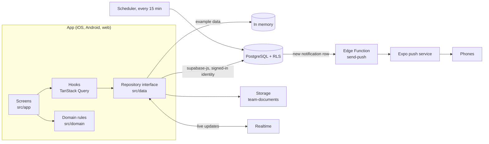

# CoachSpace — Architecture

> Technology choices, how the code is organised and how the parts talk to each other.
> Status: the app foundation exists on example data; the database is written and tested locally; **no hosted
> backend exists yet**. Read with `DATABASE.md`.

## 1. Choices

| Layer | Choice | Status | Why |
|---|---|---|---|
| App (iOS, Android, web) | **Expo SDK 58, React Native, Expo Router, TypeScript (strict)** | In place | One code base for three platforms; one person maintains it (D-007). Kept: it fits and nothing argues for a change. |
| Backend | **Supabase**, EU region: PostgreSQL, Auth, Storage, Realtime, Edge Functions, scheduler | Migrations written; project not created | Database, accounts, row-level permissions and files in one service; free plan to start (D-020). |
| Data access in the app | A `Repository` interface, implemented by Supabase and by in-memory example data | Interface and example data in place | Screens do not depend on the backend (A-013). |
| Server state | **TanStack Query** | To add (phase 0) | Caching, refetch on focus, optimistic answers (A-014). |
| Sign-in | Supabase Auth, six-digit email code | To build (phase 1) | No passwords (A-003). |
| Push notifications | Expo push service, sent by a Supabase Edge Function | To build (phase 4) | Works for iOS and Android with one API. |
| Builds and updates | Expo Application Services: Build, Update, Submit | Later (phase 6) | Cloud builds; no Xcode needed day to day. |
| Web previews | A free static hosting for preview links (EAS Hosting or Vercel) | Authorised (D-028), not set up | The owner reviews in the browser. |
| Stores | Apple Developer Program, Google Play Console | Not approved yet (O-005) | Needed for TestFlight and Play testing. |
| Code and CI | GitHub, GitHub Actions | In place | Checks on every pull request. |
| Design | Penpot (tokens, components, key screens) | In use | Free. |

**Not chosen:** a separate Next.js web app (two code bases), a wrapped web app (weak notifications), native
Swift and Kotlin apps (two apps), Firebase (weaker relational rules), an own server (maintenance).

**Costs.** Everything above has a free tier that covers development. The current limits of each free tier
(Supabase project pausing and size limits, EAS build minutes, hosting) **must be read on the official pricing
pages before relying on them**; this document does not quote them. The owner's cap is 20 € per month (D-021).

**Expo changes fast.** Before using any Expo, EAS or React Native API, read the documentation for the SDK
version in `package.json` (`AGENTS.md`). Module names in this document are choices, not API references.

## 2. The big picture



- The app reads and writes the database **directly** with the signed-in person's identity. There is no custom
  API server. Row-level security decides everything (`DATABASE.md` §6).
- Rules that span tables are database functions. Rules that are pure calculation (totals, countdown, how a
  register is pre-filled) are TypeScript functions in `src/domain/` with unit tests.
- Only two pieces of server code exist outside the database: the Edge Function that sends push notifications
  and the one that deletes an account.

## 3. Folders

```text
src/app/              Routes (Expo Router). Only screens and layouts. Thin: load, show, call.
  (auth)/             Welcome, email, code, name
  (tabs)/             Home, Calendar, Team, Chat, More
  event/[id]/         Event and its sub-screens (register, edit, squad...)
  join/[token].tsx    Invitation link
src/components/ui/    Design-system components, one per Penpot component. No data access.
src/features/<area>/  Components, hooks and helpers of one product area (events, team, chat...)
src/data/             Types, the Repository interface, implementations
  demo/               In-memory example data (invented people and teams)
  supabase/           Supabase implementation, generated database types
src/domain/           Pure rules and formatting, with unit tests beside them
src/hooks/            Shared hooks
src/i18n/             en.ts (source), es.ts, nl.ts — same keys, enforced by TypeScript
src/theme/            Tokens and fonts
src/lib/              Clients and services: Supabase client, notifications, storage of the session
supabase/migrations/  Database definition
supabase/tests/       Database tests (plain PostgreSQL)
supabase/functions/   Edge Functions (send-push, delete-account)
supabase/setup/       One-off SQL per project
docs/                 This documentation
```

## 4. Rules for the code

1. **Screens never import Supabase.** They use hooks from `src/features/`, which use the repository.
2. **Every repository method exists in both implementations.** A feature is not done until the example data
   supports it too (it powers previews and interface tests).
3. **No raw colours, sizes or fonts in screens.** Tokens from `src/theme/tokens.ts`, components from
   `src/components/ui/`. A new visual pattern becomes a component first.
4. **No hard-coded interface text.** Every text is a key in `src/i18n/`; a key missing in Spanish or Dutch
   fails the type check. Notification texts are built on the device from `type` and `data`.
5. **Every pressable control is built on `Touchable`** (pressed feedback, focus ring, 48-point target).
6. **Every screen handles four states:** loading, error with retry, empty, filled. Long names and long lists
   are part of "filled".
7. **Permissions are never only in the interface.** Hiding a button is a courtesy; the database refuses.
8. **Dates:** stored in UTC; shown in the device's time zone with `Intl` and the interface language; recurring
   events are built in the team's time zone by the database.
9. **No secrets in the app.** Only the public Supabase URL and anonymous key (`EXPO_PUBLIC_…`). Service keys
   live only in Supabase function secrets and in the Claude environment's secrets.
10. **One way to do each thing.** Before adding a helper, a hook or a component, look for the existing one.

## 5. Data access

```ts
// src/data/repository.ts — split by area as it grows
interface Repository {
  auth: AuthRepository;        // session, sign in with code, sign out
  teams: TeamsRepository;      // my teams, create, settings, roster, invitations, join requests
  events: EventsRepository;    // list, get, create, series, change, cancel, answers, register, remind
  messages: MessagesRepository // chat, announcements, read marks
  documents: DocumentsRepository
  notifications: NotificationsRepository
  // level 2 and Coach Pro areas are added when built
}
```

- The implementation is chosen in `src/data/index.ts` from `EXPO_PUBLIC_DATA_SOURCE` (`supabase` or `demo`).
  Preview builds for design review use `demo`; everything else uses `supabase`.
- Hooks wrap repository calls in TanStack Query: one query key per resource (`['events', teamId]`,
  `['event', eventId]`, `['answers', eventId]`…); mutations invalidate the keys they affect. Answering uses an
  optimistic update so the slide feels instant.
- **Live updates** (Supabase Realtime) only where they matter: chat messages and answers of the open event.
  Everything else refetches on focus and after mutations.
- Database types are generated from the schema into `src/data/supabase/database.types.ts`; never written by hand.
- The current hand-made `useQuery` hook and single-file repository are the starting point to be replaced in
  phase 0 (`IMPLEMENTATION_PLAN.md`).

## 6. Notifications

1. On sign-in the app asks for permission at the first useful moment (after joining a team, not on launch),
   and stores the device's push token in `push_tokens`.
2. The database creates a row in `notifications` for each person (`DATABASE.md` §5).
3. A database webhook calls the Edge Function `send-push` for each new row. It reads the person's tokens and
   language, writes the text from `type` and `data`, sends it through the Expo push service, sets `pushed_at`
   and removes tokens the service reports as invalid.
4. Tapping a notification opens the event or screen it refers to.
5. The same rows feed the in-app notification list; `read_at` is set when the list is opened.

Push notifications need a development or store build on a real device; they do not work in Expo Go on
Android or in a simulator. On the web version there are no push notifications in the first version.

## 7. Sign-in and sessions

- Email → six-digit code → session. The session is stored on the device (secure storage on phones) and
  refreshed automatically. Signing out removes it and the device's push token.
- First sign-in asks for a name and creates the profile.
- Invitation links: `…/join/<token>`. Opened on the web they show the web app; once a domain exists, the same
  links open the installed app (universal links, phase 6). Until then the app also accepts a pasted link.
- The email template must contain the code, not only a link (set in the Supabase dashboard; `SETUP_SUPABASE.md`).

## 8. Files

Documents are uploaded to the private bucket `team-documents` at `<team_id>/<document_id>/<file name>`;
access follows team membership. Files are opened through short-lived signed links. Limit: 10 MB; PDF, JPEG,
PNG, Word and Excel.

## 9. Environments

| Environment | Database | App build | Purpose |
|---|---|---|---|
| Example data | None | Web preview | Design review without an account |
| Development | Supabase project `coachspace-dev` (EU) | Web preview, development builds | Building and testing with invented data |
| Production | A separate Supabase project | Store builds | Real users. Created only with the owner's approval, before the beta |

No real personal data in development. Migrations go to development first, then to production.

## 10. Testing and CI

| Level | Tool | What | Runs |
|---|---|---|---|
| Static | ESLint, TypeScript | Style, types, missing translations | CI, every pull request |
| Domain | Jest (`jest-expo`) | Pure rules in `src/domain/` | CI |
| Components and screens | React Native Testing Library on example data | States, permissions shown, texts | CI |
| Database | `supabase/tests/run.sh` on PostgreSQL 16 | Access rules and functions | CI |
| End to end (web) | Playwright on the web build with example data | Main flows per role | CI |
| Backend integration | Script against the development project | Sign-in, files, live updates, push | By hand per phase |
| Devices | Development builds on Android and a borrowed iPhone | Gestures, notifications, safe areas | Per phase, with the owner |

`npm run check` = lint + type check + web build today; unit tests, database tests and end-to-end tests join it
as they are added. CI must stay under ten minutes.

## 11. Scale and maintenance

The target is hundreds of teams, not millions of users. What matters:

- Every policy uses indexed lookups through three helper functions; indexes exist on every foreign key used
  for filtering.
- Recurring events are rows (about a hundred per team per season): simple queries, no rule expansion on phones.
- Chat is paginated by time; nothing loads a whole history.
- Notifications are a table, so a failed push is visible and can be retried.
- Things to revisit only if needed: partitioning `messages` and `notifications`, archiving old seasons.

## 12. Known limits

- Packages are installed with npm because the Expo installer cannot reach its compatibility service from the
  cloud environment; versions of Expo modules come from the list bundled with the SDK.
- iOS and Android have not been run yet; only the web build has been verified.
- The Supabase-specific parts of the database (auth, storage transfer, live updates, scheduler, webhooks) are
  untested until the development project exists.
- Dutch texts will be written by Claude and need a native review.
