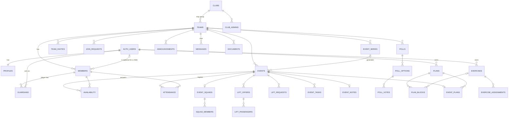

# CoachSpace — Database

> The data model, its rules and who can do what. The SQL in `supabase/migrations/` is the exact definition;
> this document explains it. If they disagree, fix the document or write a new migration — never edit an
> applied migration.
> Status: **written and tested on a local PostgreSQL 16; not yet applied to any hosted project.**

## 1. Overview

- PostgreSQL (Supabase), schema `public`. Accounts live in Supabase's `auth.users`.
- **Every table has row-level security.** The app talks to the database directly with the signed-in person's
  identity; what they can read or change is decided by policies in the database, not by the interface.
- Rules that involve several tables are **database functions** the app calls (create a team, approve a join
  request, save a register...). They check permissions themselves.
- 35 tables in four migrations:

| Migration | Contents | Built in |
|---|---|---|
| `…000100_core.sql` | Profiles, clubs, teams, members, guardians, invitations, join requests, events and series, availability, attendance, reminders, announcements, chat, documents, read marks, push tokens, notifications | Level 1 |
| `…000200_level2.sql` | Coach notes, squads, polls, lifts, tasks | Level 2 |
| `…000300_library.sql` | Entitlements, exercises, plans, plan blocks, event plans, assignments | Coach Pro |
| `…000400_storage.sql` | Private file bucket `team-documents` and its access rules | Level 1 (documents) |

All four are applied together from the start: empty tables cost nothing and the model never has to be rebuilt.

## 2. How the main things relate

### The three ideas that hold the model together

1. **A member is a place in a team, not an account.** `members` has one row per person per team, with a role
   (`coach`, `assistant_coach`, `player`). `user_id` links it to an account and is **empty for a child**.
2. **A guardian is a link**, not a role: `guardians (member_id, user_id)` says "this account acts for this
   player". A parent with two children in two teams has one account and two links. A coach who is also a
   parent has a coach member row and a guardian link.
3. **Everything belongs to a team.** Events, chat, documents and polls carry `team_id`; things inside an
   event reach the team through the event. Access always reduces to three questions answered by functions:
   `is_team_coach(team)`, `is_team_person(team)` (coach, player with an account, or guardian) and
   `can_act_for(member)` (the player or one of their guardians).

The exception is the **library**: exercises and plans belong to the coach's account (`owner_id`), because a
coach reuses them across teams. The team reads a plan only while it is attached to one of its events, and an
exercise only when it was assigned to them or sits in a readable plan.

## 3. Tables

Types: `uuid` keys generated by the database; times are `timestamptz` (stored in UTC); text lengths are
enforced with checks. "→" means a foreign key. Deleting a team deletes everything under it.

### Identity and teams

| Table | Key | Main fields | Notes |
|---|---|---|---|
| `profiles` | `user_id` → auth.users | `display_name` (1–80), `language` (`en`, `es`, `nl`) | Created at first sign-in. The email stays in `auth.users` and is never shown to others. |
| `clubs` | `id` | `name`, `created_by` | Level 3. No writes from the app yet. |
| `club_admins` | (`club_id`, `user_id`) | | Level 3. |
| `teams` | `id` | `club_id` → clubs (optional), `name` (1–60), `sport` (`basketball`, `football`, `tennis`, `other`), `timezone`, `season_start`, `chat_mode` (`open`, `coaches_only`), `reminder_hours` (1–72 or empty = off), `archived_at` | Created with `create_team`. |
| `members` | `id` | `team_id` → teams, `role`, `user_id` → auth.users (optional), `display_name`, `number` (0–999), `position` (≤40), `left_at` | One active row per account and team. A coach row always has an account. `left_at` marks someone who left; history is kept. |
| `guardians` | (`member_id`, `user_id`) | | Created only by approving a join request. |
| `team_invites` | `id` | `team_id`, `kind` (`member`, `coach`), `token` (unique, random), `expires_at`, `revoked_at`, `used_at` | The member link is permanent until revoked; a coach link works once. |
| `join_requests` | `id` | `team_id`, `user_id`, `kind` (`player`, `guardian`), `player_name`, `status` (`pending`, `approved`, `rejected`), `decided_by`, `member_id` | No duplicate pending request for the same person and player name. |

### Events

| Table | Key | Main fields | Notes |
|---|---|---|---|
| `event_series` | `id` | `team_id`, `type`, `title`, `weekdays` (1 = Monday … 7), `start_time`, `duration_minutes` (15–600), `place`, `starts_on`, `ends_on` (at most a year) | A weekly rule. Its events are real rows. |
| `events` | `id` | `team_id`, `series_id` (optional), `type` (`training`, `match`, `tournament`), `title` (opponent or tournament; empty for a training), `starts_at`, `ends_at`, `place`, `venue` (`home`, `away`), `note` (≤500), `status` (`scheduled`, `cancelled`), `detached` | `detached` = changed on its own, so "this and following" edits skip it. Index on (`team_id`, `starts_at`). |
| `availability` | (`event_id`, `member_id`) | `answer` (`in`, `out`), `answered_by`, `answered_at` | No row = no answer. Writable until the event starts. |
| `attendance` | (`event_id`, `member_id`) | `present`, `recorded_by`, `recorded_at` | Written only by `save_register`, once the event has started. |
| `event_reminders` | `id` | `event_id`, `kind` (`auto`, `manual`), `sent_by`, `recipients`, `sent_at` | Prevents duplicate reminders. |

### Communication and files

| Table | Key | Main fields | Notes |
|---|---|---|---|
| `announcements` | `id` | `team_id`, `author_id`, `title` (1–80), `body` (1–2000) | |
| `messages` | `id` | `team_id`, `author_id`, `body` (≤2000), `deleted_at`, `deleted_by` | Deleting erases the text and keeps the row as a mark. No editing. |
| `documents` | `id` | `team_id`, `kind` (`file`, `link`), `title`, `url` (https only) or `storage_path`, `mime_type`, `size_bytes` (≤10 MB) | A file lives in the private bucket at `<team_id>/<document_id>/<file name>`. |
| `read_state` | (`team_id`, `user_id`) | `chat_seen_at`, `announcements_seen_at` | For unread marks. |
| `push_tokens` | `token` | `user_id`, `platform` | One row per device. |
| `notifications` | `id` | `user_id`, `team_id`, `event_id`, `type`, `data` (values, never text), `read_at`, `pushed_at` | Created only by database functions; the app writes the text in the reader's language. |

### Level 2

| Table | Key | Main fields | Notes |
|---|---|---|---|
| `event_notes` | `event_id` | `body` (1–2000) | Coaches only. |
| `event_squads` | `event_id` | `published_at` | Players see a squad only once published. |
| `squad_members` | (`event_id`, `member_id`) | `starter`, `sort` | Players of the event's team only. |
| `polls` | `id` | `team_id`, `question` (1–200), `multiple`, `closes_at` | Created with `create_poll` (2–10 options). |
| `poll_options` | `id` | `poll_id`, `label`, `sort` | |
| `poll_votes` | (`option_id`, `user_id`) | `poll_id` | One vote per account; written by `vote_in_poll`. |
| `lift_offers` | `id` | `event_id`, `driver_id`, `seats` (1–8), `leaves_at`, `note` (≤120) | One offer per driver and event. |
| `lift_passengers` | (`offer_id`, `member_id`) | `event_id` | A player rides in one car per event; never more passengers than seats. |
| `lift_requests` | `id` | `event_id`, `member_id`, `note` | One per player and event; removed when the player gets a seat. |
| `event_tasks` | `id` | `event_id`, `title`, `claimed_by`, `claimed_at` | Taken and given back with `claim_task`. |

### Coach Pro

| Table | Key | Main fields | Notes |
|---|---|---|---|
| `entitlements` | (`user_id`, `feature`) | `feature` (`library`), `source` (`beta`, `purchase`, `club`), `valid_until` | Granted by hand during the beta. |
| `exercises` | `id` | `owner_id`, `title`, `category`, `description`, `coaching_points`, `video_url` (YouTube or Vimeo only), `duration_minutes`, `archived_at` | |
| `plans` | `id` | `owner_id`, `title` | |
| `plan_blocks` | `id` | `plan_id`, `sort`, `exercise_id` (optional), `title`, `minutes` (1–180), `notes` | |
| `event_plans` | `event_id` | `plan_id` | One plan per event at most. |
| `exercise_assignments` | `id` | `exercise_id`, `team_id`, `member_id` (empty = whole team), `note` | |

## 4. Functions the app calls

| Function | Who | What it does |
|---|---|---|
| `create_team(name, sport, timezone)` | Any signed-in person with a name | Creates the team, makes the caller its coach and creates the invitation link. |
| `get_invite(token)` | Anyone, even without an account | Returns only the team's name and sport for a valid link. |
| `request_to_join(token, kind, player_name)` | Signed-in | Creates a pending request (player or guardian) and tells the coaches. With a coach link: joins as assistant coach at once and uses up the link. |
| `decide_join_request(request, approve, existing_member)` | Coaches | Approves (linking to an existing roster player or creating one) or rejects, and tells the requester. |
| `create_event_series(...)` | Coaches | Creates the weekly rule and its events in the team's time zone; one notification for the whole series. |
| `update_following_events(event, start_time, minutes, place)` | Coaches | "This and following": changes the event and the later, not individually changed, events of its series. |
| `cancel_following_events(event)` | Coaches | Cancels the event and the later ones; later ones nobody answered are removed. |
| `save_register(event, entries)` | Coaches | Saves or corrects the register of an event that has started. |
| `remind_unanswered(event)` | Coaches | Notifies those who can answer for players without an answer; at most once an hour per event. |
| `delete_message(message)` | Author or coaches | Erases the text of a chat message. |
| `leave_team(member)` | The player or a guardian | Leaves; the only coach cannot leave. |
| `attendance_summary(team)` | Team | Sessions and presences per player this season: everyone for coaches, own players for the rest. |
| `create_poll`, `vote_in_poll`, `poll_results` | Coaches; team; team | Results are counts; who voted what is visible to coaches only. |
| `claim_task(task, claim)` | Team | Takes a free task or gives one back; a coach can free any. |
| `has_feature(feature)` | Signed-in | Whether the caller has a paid feature. |

Run by the server only: `queue_due_reminders()` (every 15 minutes, one automatic reminder per event).

Everything else is a plain read or write on a table, allowed or refused by the policies below.

## 5. Notifications created by the database

| When | Type | To |
|---|---|---|
| A single event is created | `event_created` | Players' accounts and guardians |
| A series is created | `event_created` (with the count) | The same, once |
| Time or place of a future event changes | `event_changed` | The same |
| A future event is cancelled | `event_cancelled` | The same |
| Reminder, automatic or manual | `reminder` | Those who can answer for players without an answer |
| Someone asks to join | `join_request` | Coaches |
| A request is decided | `join_approved`, `join_rejected` | The requester |
| An announcement is posted | `announcement` | Everyone except the author |
| A squad is published | `squad_published` | Players' accounts and guardians |
| A poll is created | `poll_created` | Everyone except the author |

The person who made the change is never notified about it. A server function sends each new row as a push
notification (`ARCHITECTURE.md` §6).

## 6. Who can do what (as enforced by the policies)

"Team" = anyone in the team: coaches, players with an account, guardians. "Own" = the player themselves or
their guardians.

| Data | Read | Create | Change | Delete |
|---|---|---|---|---|
| Profile | Self; people who share a team | Self | Self | With the account |
| Team | Team | `create_team` | Coaches | — (archive) |
| Roster (`members`) | Team | Coaches (players without account); join requests | Coaches; roles only the coach | — (`left_at`) |
| Guardian links | Coaches; the guardian | By approval | — | Coaches; the guardian leaves |
| Invitation links | Coaches | Coaches | Coaches (revoke) | — |
| Join requests | Requester; coaches | `request_to_join` | `decide_join_request` | Requester while pending |
| Events, series | Team | Coaches | Coaches | Coaches |
| Answers | Team | Own; coaches — until the start | Same | — |
| Register | Coaches; own rows | Coaches, after the start | Coaches | — |
| Announcements | Team | Coaches | — | Coaches |
| Chat messages | Team | Team while the chat is open; coaches always | — | Author; coaches |
| Documents and files | Team | Coaches | Coaches | Coaches |
| Notifications | Self | Database only | Self (read mark only) | — |
| Coach notes | Coaches | Coaches | Coaches | Coaches |
| Squad | Coaches; team once published | Coaches | Coaches | Coaches |
| Polls | Team (votes: own; coaches) | Coaches | Coaches | Coaches |
| Lift offers | Team | Any team person, as driver, before the start | Driver | Driver |
| Lift seats | Team | Own; the driver for a player who asked | — | Own; the driver |
| Lift requests | Team | Own | — | Own |
| Tasks | Team | Coaches | Coaches; `claim_task` | Coaches |
| Exercises, plans | Owner; team through an attached plan or an assignment | Owner with Coach Pro | Owner with Coach Pro | Owner |
| Plan of an event | Team | Coach who owns the plan, with Coach Pro | Same | Coaches |

A visitor without an account can do one thing: read the name and sport of a team from a valid invitation link.

## 7. Integrity rules worth knowing

- A team always has at least one coach: the last coach cannot leave or be demoted.
- An account is attached to a player only by approving a join request, never by editing the roster.
- A member cannot move to another team; an event cannot move to another team.
- A coach is never in a squad or a car as a passenger: both are players only.
- Video links must be YouTube or Vimeo; document links must be `https`.
- A notification's content cannot be changed by the person who received it; only its read mark.

## 8. Personal data and retention

- Stored about a person: name, language, email (in `auth.users`), the teams they belong to, their answers,
  attendance, messages, and for players a shirt number and position. **Not stored:** birth date, phone,
  address, photos, health information, reasons for absence.
- A child is a name on a roster and nothing else.
- **Leaving a team** sets `left_at`: the person disappears from lists; past registers keep their row so that
  team statistics stay true.
- **Deleting an account** (required by the stores and by GDPR; built in phase 6) removes the profile, guardian
  links, push tokens, notifications and votes; messages stay without an author; member rows lose the account
  link and get a neutral name ("Former member"). It needs a server function because only the server can
  delete from `auth.users`.
- A coach can remove a player; **erasing** a removed player's history on request is a server-side operation
  documented in `SETUP_SUPABASE.md`.
- Hosting in an EU region. Development and production are separate projects.

## 9. Migrations

- Files in `supabase/migrations/`, named `YYYYMMDDHHMMSS_name.sql`, applied in order. **Never edit a migration
  that has been applied to a hosted project; write a new one.** Until the first project exists, the four
  files may still be corrected in place.
- Every migration ends by removing access for visitors without an account and by granting the new functions
  only to signed-in users.
- Supabase-only settings (live updates, the reminder schedule) are in `supabase/setup/after_migrations.sql`,
  run once per project.
- Destructive changes (dropping a column or table with data) need the owner's explicit approval.

## 10. Tests

`supabase/tests/run.sh` creates an empty database, applies a shim (the few things Supabase provides: roles,
`auth.uid()`, a storage table) and the migrations, and runs `access_test.sql`: more than a hundred checks of
who can see and change what between two coaches of different teams, an assistant, a player, a guardian, a
stranger and a visitor. It runs in CI on every pull request. Add checks there with every migration.

Not covered by these tests: Supabase's own services (sign-in, file transfer, live updates, the scheduler).
They are checked against the development project in phase 1.
