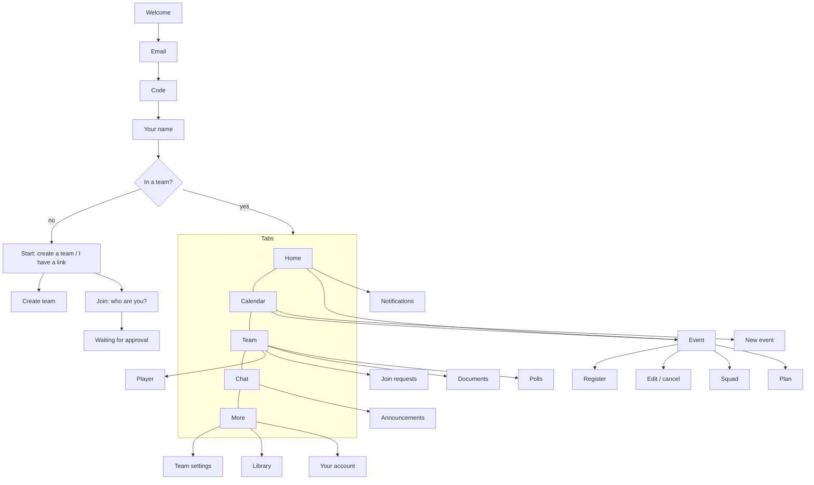

# CoachSpace — UX specification

> Navigation, screens per role and the rules of the interface. The visual rules (colour, type, spacing,
> components) are in `DESIGN.md` and in the Penpot file; what each function does is in
> `FEATURE_SPECIFICATIONS.md`. This document is the map that connects them.
> Status: **approved basis for building** (A-012). Screens marked ◆ exist in Penpot; the rest are composed
> from the existing components following this document.

## 1. Principles of the interface

1. **The number the person came for is the biggest thing on the screen** (the time, how many are in).
2. **One primary action per screen**, in orange, at the bottom or in the hero. Everything else is quieter.
3. **Black block on top, white list below.** The black hero holds the fact and the action; lists are plain
   rows with dividers. No floating cards, no shadows, square corners.
4. **Same five tabs for everyone.** What changes with the role is what is inside, never where things are.
5. **State is never colour alone:** answers carry an icon and a word.
6. **Every list row that opens something is pressable as a whole.**
7. **Nothing appears that cannot be used.** A control the person has no permission for is absent, not disabled.

## 2. Navigation

- **Tab bar** (phones, under 600 px wide): Home · Calendar · Team · Chat · More. The active tab has a filled
  icon and a dark label. Unread marks: a dot on Chat (new messages or announcements) and on Home's bell.
- **Team switcher:** the small line above each tab title shows the team's name; with more than one team it is
  pressable and opens a sheet listing the person's teams, "Create a team" and "Join with a link".
- **Stack screens** (Event, Register, New event, Notifications, settings…) open over the tabs with a top bar:
  back arrow, context label, and at most one action on the right.
- **Wide screens:** the phone layout in a centred column up to 600 px (D-027).
- **Deep links:** `/join/<token>`, `/event/<id>`; a notification opens the screen it is about.

## 3. Screens

Roles: **C** coach and assistant, **P** player (16+), **G** guardian. Feature codes refer to
`FEATURE_SPECIFICATIONS.md`.

### Start

| Screen | Route | Contents | Feature |
|---|---|---|---|
| Welcome / Email ◆ | `/(auth)/sign-in` | Black screen: "Sign in", one line "No password. We send a code to your email", email field, primary "Send me the code" | F-01 |
| Code | `/(auth)/code` | Six-digit field, "Send again" after 30 s, wrong-code error | F-01 |
| Your name | `/(auth)/name` | One field; primary "Continue" | F-01 |
| Start (no team) | `/start` | Two choices: "Create a team" (primary), "I have an invitation link" (paste field) | F-02, F-03 |
| Create team | `/team/new` | Name, sport (four choices); primary "Create team" | F-02 |
| Join ◆ | `/join/[token]` | Black block: "You are invited to" + team name + sport. "Who are you?": "I am a player (16 or older)" / "I am a parent or guardian" (then the child's name). Primary "Ask to join" | F-03 |
| Waiting | `/join/pending` | "Your request is with the coach." The person can cancel it | F-03 |

### Home — `/(tabs)/index`

| Block | Coach | Player / guardian |
|---|---|---|
| Header ◆ | Team · role, "Today", bell with unread dot, own avatar | The same |
| Next event (black hero) ◆ | Type, countdown tag, time (huge), day and place, the three totals with the bar, primary **Remind N players** (or "Reminder sent · 14:05", or "Everyone has answered"). Pressing the time opens the event | Type, countdown, time, day and place, **"Are you coming?"** with slide to answer and "I can't come"; once answered: the answer block and "Change answer". A guardian with several children sees one answer row per child |
| Needs you | Rows, only when they exist: "2 people ask to join", "Register to take · Thu 19 Nov" | "Answer needed · 2 events", "Poll · Which kit on Saturday?", "You are in the squad · Sat" |
| Latest announcement | Pinned row with title, first line, author and date; opens Announcements. Can be dismissed until a newer one | The same |
| Coming up | Next three events after the first: date, title (tag for match and tournament), time, place, "6 of 14 answered" | The same rows; the meta line ends with the person's own answer: "you are in" / "answer needed" |
| Empty ◆ | "No events yet" + primary "Add first event"; below, "Only you so far" + "Share invite link" | "Nothing planned yet." |

### Calendar — `/(tabs)/calendar` ◆

- Title: the word "Calendar"; right action for coaches: **+** (New event).
- A switch **List · Month**. List (default): events grouped by month, as rows. Month: a grid with a mark on
  days with events and the selected day's events below.
- Cancelled events stay in the list for a week with a "Cancelled" tag and struck-through time, then disappear.

### Event — `/event/[id]` ◆

One screen for every role; sections appear in this order when they apply.

| # | Section | Who | Contents |
|---|---|---|---|
| 1 | Hero (black) | All | Countdown tag and type; opponent or tournament name; day; time range (large); place; note; totals and bar |
| 2 | Your answer | P, G | Slide to answer / answer block / "Change answer", per child for guardians. Closed after the start: "Answers are closed" |
| 3 | Squad | All, matches and tournaments | Coach: "Pick the squad" → Squad screen; once published: starters and bench. Players: only once published; "You are in the squad" or "You are not in the squad this time" |
| 4 | Who's coming | All | Three groups in this order: No reply · N, Out · N, In · N. Each row: avatar, name, number and position, answer. A coach can press a row to record an answer for that player |
| 5 | Plan | All, if a plan is attached | Title, total minutes, blocks with start–end minute; opens the read-only plan. Coaches with Coach Pro and no plan: "Choose a plan" |
| 6 | Lifts | All | Offers (driver, seats left, departure, note, passengers), requests, "Offer a lift", "Need a lift" |
| 7 | Tasks | All | Rows: task and who took it; "I'll do it" on free ones. Coaches: "Add task" |
| 8 | Notes | C | "From last time" (previous event's note, read-only) and "Note for next time" |
| — | Footer primary | C | Before the start: **Remind N players** (hidden when nobody is missing or one was just sent). From the start: **Take the register** / "Edit the register" |
| — | Top-bar action | C | "…" → Edit, Cancel event |

A cancelled event shows a "Cancelled" block instead of sections 2–7.

### Event sub-screens (coaches)

| Screen | Route | Contents | Feature |
|---|---|---|---|
| New event ◆ / Edit | `/event/new`, `/event/[id]/edit` | Type (three segments), opponent or tournament name (not for trainings), day, start and end time, place, home/away (matches), repeat (trainings: weekdays + until), note. Primary "Create and ask the team" / "Save". Editing a repeating event asks "This event" or "This and following" | F-05 |
| Register ◆ | `/event/[id]/register` | Count "10 of 14 here" with bar; one row per player with what they answered and two square toggles (here / absent). Primary "Save register" | F-08 |
| Squad | `/event/[id]/squad` | Players who answered in first, then the rest; each row toggles Out → Bench → Starter; counts on top; "Publish squad" primary | F-17 |
| Plan (read-only) | `/event/[id]/plan` | Blocks in order: minute range, title, minutes, coaching points, video link | F-23 |

### Team — `/(tabs)/team` ◆

- Header: "14 players · 2 coaches", team name.
- Coaches: a row "N people ask to join" (opens Join requests) when there are any; block "Invite by link" with
  "Share invite link".
- A switch **Players · Documents · Polls · Stats**.

| Segment | Contents |
|---|---|
| Players | Coaches · N, then Players · N: avatar, name, number and position. Coaches also see "guardian: name" and can open a player: edit name, number, position; guardians list; "Remove from team". Coaches: "Add player" (a roster entry without account) |
| Documents ◆ | Rows with a PDF / LINK / IMG tag, title, who added it and when. Coaches: **+** → "Upload a file" / "Add a link"; long press or "…" on a row → rename, delete |
| Polls | Open polls first, then closed: question, options with counts and bars, the person's choice marked. Coaches: "New poll" |
| Stats | Coaches: season attendance in large type, last events as rows "Thu 12 Nov · 8 of 10" (open the saved register), players sorted by attendance. Players and guardians: only their own figure and their own list of events |

| Screen | Route | Contents | Feature |
|---|---|---|---|
| Join requests | `/team/requests` | One row per request: name, "player" or "guardian of <name>", when. Approve → choose "New player" or an existing roster player without account; Reject | F-03 |

### Chat — `/(tabs)/chat` ◆

- A switch **Chat · Announcements**.
- Chat: messages oldest to newest, own messages right in black, others left in grey with the author's name;
  day separators; a deleted message shows "Message deleted". Composer at the bottom with send button. When the
  chat is closed to players they see "Only coaches can write here" instead of the composer.
- Announcements: newest first; title, text, author, date. Coaches: "New announcement" (title and text).

### More — `/(tabs)/more` ◆

| Row | Who | Opens |
|---|---|---|
| Library | C (shows "Coach Pro" when not enabled) | Exercises and Plans (F-22 to F-24) |
| Team settings | C | Team name, sport, season start, automatic reminder (off / hours before), who can write in the chat, invite a coach, reset the invitation link |
| Language | All | English, Español, Nederlands |
| Your account | All | Name, email (read-only), "Leave this team", "Delete my account" |
| Sign out | All | — |

| Screen | Route | Contents | Feature |
|---|---|---|---|
| Notifications ◆ | `/notifications` (from Home's bell) | Newest first: title, one line, time; unread ones carry a "New" tag; pressing opens what it is about | F-12 |

### Library (Coach Pro) — `/library`

A switch **Exercises · Plans**. Exercises: search, rows with title, category and minutes; exercise screen with
description, coaching points, video link, "Assign". Plans: rows with title, total minutes and where it is
used; plan editor with ordered blocks; "Use in an event". Without Coach Pro the screen explains what it is
and says it is not available yet for the account; nothing is sold in the app (A-011).

## 4. States every screen has

| State | Rule |
|---|---|
| Loading | The screen frame at once; a spinner in the content area. Never a blank screen. Lists keep old data while refreshing |
| Error | "Something went wrong" + one line + "Try again". A failed action shows a message at the bottom and keeps what the person typed |
| Empty | One sentence that says what will appear and, if the person can create it, the action |
| No permission | The control is absent. A deep link to something not allowed shows "You cannot see this" with a way back |
| Offline | Last loaded data stays; actions fail with "No connection. Try again" |
| Long content | Names wrap to two lines then cut; the time in the hero shrinks to fit; lists scroll; rows never grow wider than the screen |

## 5. Interaction details

- **Slide to answer:** drag the orange handle to the right edge to answer "in"; it locks with a haptic tick
  and becomes the answer block. With a screen reader or keyboard the control is a button "I'm in" (also
  reachable by a double tap on the handle). "I can't come" is a plain button under it.
- **Haptics:** on answering, on sending a reminder, on an error.
- **Countdown** refreshes every 30 seconds; under an hour it shows minutes; after the start, "Started".
- **Pull to refresh** on Home, Calendar, Event, Team, Chat.
- **Sheets** (from the bottom) for short choices: team switcher, "this event / this and following", confirmations.
- **Destructive actions** (cancel an event, remove a player, delete a document, delete the account) always ask
  for confirmation in a sheet naming what will happen.
- **Focus order** follows reading order; every control has a visible focus ring and an accessible name.

## 6. Words

- Short, plain, British English as the source. Buttons say what happens: "Create and ask the team",
  "Save register", "Share invite link".
- The team is "team" everywhere. Events are "training", "match", "tournament". Answers are "in" and "out".
- Dates: "Thu 19 Nov"; times in 24 hours: "18:00". Formatting follows the interface language.
- Translations (Spanish, Dutch) keep the same length discipline: a label fits one line at 320 px.

## 7. Penpot: what to update when convenient (does not block building)

- Remove the screen "Player / Event — can't come" (no reasons, D-024).
- Replace the text "not sent yet" in event rows with the answered count (A-004).
- Add reference frames for: Code, Join requests, Squad, Lifts and Tasks sections, Polls, Stats, Library.
- Tablet and desktop frames come with the desktop layout (later).
